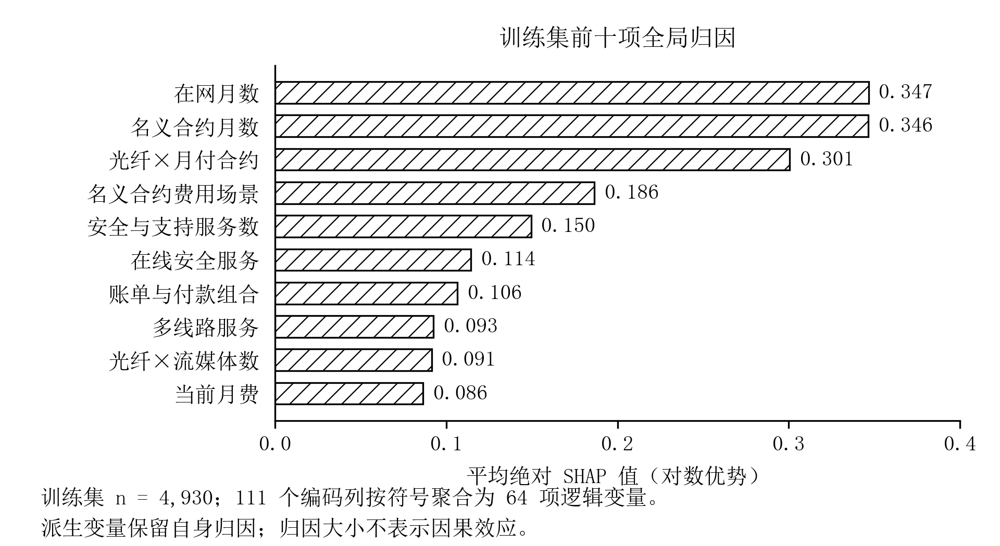
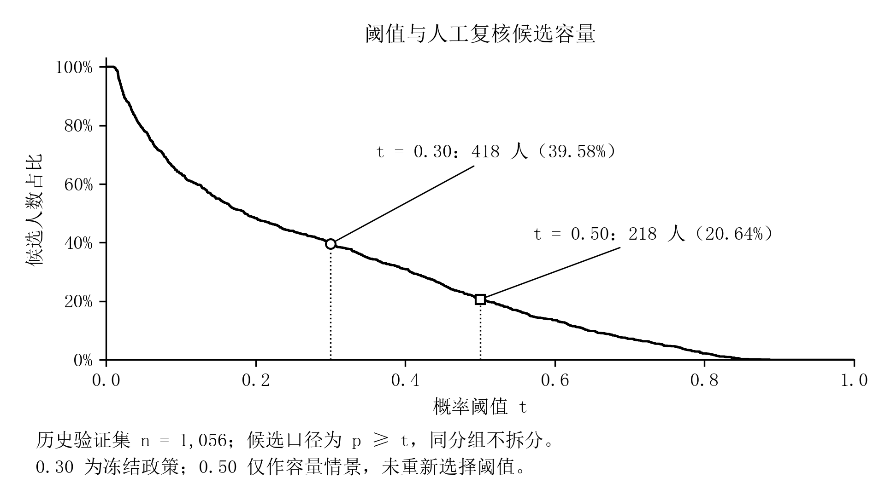
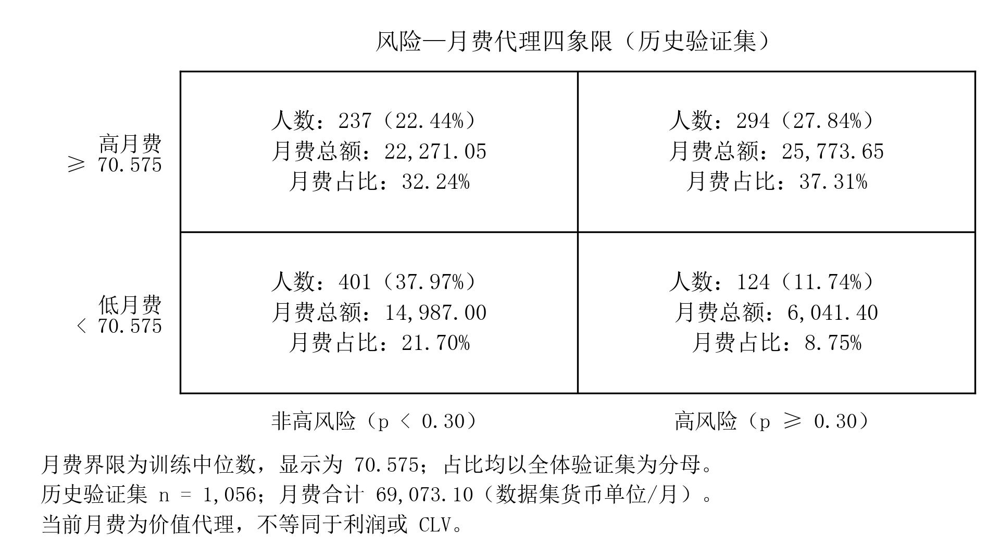

# 客户流失预测与价值分层研究

基于公开代理数据的实证分析

## 摘要

针对客户流失识别与资源配置问题，本文基于公开客户数据，研究特征构建、预测建模、模型解释、推理优化和价值分层。监督学习使用7,043名Telco客户，其他资料因缺少可靠关联键未合并训练。比较传统分类器、树集成、表格模型及概率融合后，保留历史XGBoost模型；其验证集AUC为0.852193，F1为0.656160，召回率为0.817857，未达到预设效果目标。保持预测输出不变的工程优化将1,056行热请求中位耗时由52.26 ms降至10.14 ms，主要收益来自数据校验、特征派生和编码。风险与月费矩阵识别出294名高月费高风险客户，占验证集27.84%，对应月费占比37.31%。研究形成了可复核的分析流程，但公开代理数据、验证集重复使用及时间信息不足限制了外部推广；月费分层不能替代真实生命周期价值或因果收益估计。

关键词：客户流失；特征工程；模型解释；推理优化；客户分群

## 1 引言

客户流失研究需兼顾预测质量、运行成本与客户价值，并区分横截面关联、动态行为及干预效果。

本文以Azure客户管理为背景，使用公开代理数据验证方法，研究对象并非真实Azure客户。研究覆盖数据治理、特征与模型比较、解释、推理优化及风险与月费分层。贡献在于可审计的实证比较和工程实现，不涉及新算法；按预测效果、运行效率和描述性业务结果分别评价。

## 2 数据与研究设计

### 2.1 数据来源与清洗

采用已归档的三类公开数据[1,2,3]。Telco包含7,043名客户和21个原始字段，流失客户1,869名，占26.54%；工单资料包含8,469条记录、17列；SaaS资料由十张汇总表构成，共50条记录。三者缺少可信共同客户键及预测前时间关系，故仅Telco用于监督学习，其他资料用于独立分析。

清洗保留全部客户及原标签。累计费用字段的7,032个非空值全部成功转换为数值，11个空白保留为缺失，不视为真实零金额。清洗表包含25列；排除标识与目标后，19项业务属性及3项确定性标记构成22项输入。模型所需插补、标准化和编码参数仅在对应训练范围内估计。

探索分析显示，月付、一年及两年合同客户的流失比例分别为42.71%、11.27%和2.83%，合同关联的Cramér's V为0.4101。分析服务组合时必须固定适用人群：互联网客户中，附加服务数量与流失标签的Spearman相关为-0.2879；加入无互联网客户后相关减弱至-0.0600，说明结构性“不适用”会改变统计关系。上述结果仅支持横截面关联。

### 2.2 样本划分与评价协议

正式建模采用随机种子42的分层划分，训练、验证及历史测试集分别为4,930、1,056和1,057人，正类分别为1,308、280和281人。训练集内实施五折交叉验证。缺少可信事件日期使时间切分不可实施；早期全量探索及历史测试记录也意味着现有测试集不能视为完全未接触的盲测。

评价指标包括AUC、平均精确率AP、正类F1、Precision、Recall及Brier分数。AP不等同于梯形积分的PR曲线面积。早期候选在验证集选择阈值，后续候选主要依据训练集折外预测（OOF）确定阈值；两类协议分别标注，不进行无条件比较。最终模型区间采用固定模型与阈值下的分层bootstrap，不包含重新训练和模型选择的不确定性。

## 3 研究方法

### 3.1 特征构建与模型比较

特征工程由22项基础输入构建64项逻辑候选，编码后为111列。互信息、L1正则和递归消除用于筛选，并结合方差、相关性与方差膨胀因子诊断。交叉验证期间，估计与筛选仅在训练折拟合。该实验使用5,634/1,409的开发与留出划分，与正式建模划分不同，故仅在自身协议内比较。全开发集筛选器最终保留27列，未满足至少50项最终特征的要求；预设筛选上限40亦低于该目标。

基线比较两种特征表示、Logistic回归与决策树，以及原比例、类别权重、SMOTE和ADASYN，共16个候选。重采样限定于训练集。进一步比较XGBoost、LightGBM、CatBoost、SVC、ExtraTrees、样条Logistic、EBM、TabPFN、TabM和TabICLv2，并研究Stacking、Blending、分组专家、focal损失与排序目标。树模型及自动搜索分别采用已有算法和Optuna框架[4,5]。

实验登记共19条研究路线、46条验证记录及155条OOF评分记录，包含重复基线、阈值探索、学习曲线和算术融合，不代表相同数量的独立模型。后期采用min(F1/0.80,AUC/0.88)衡量联合目标完成程度。

### 3.2 解释与风险容量

对冻结模型采用Tree SHAP，以tree_path_dependent模式在对数优势空间分解预测，将编码列的带符号贡献聚合至逻辑变量，再计算平均绝对贡献[6]。局部解释比较LIME代理模型，要求各随机种子的加权留出R²≥0.70且个体概率误差≤0.05[7]。

风险分值定义为100p，按未舍入概率划分低风险[0,0.10)、中风险[0.10,0.30)和高风险[0.30,1]。阈值t对应人数为预测概率不低于t的客户数。容量分析保留全部同分客户，预算阈值仅依据概率确定，标签用于事后评价；零候选时精确率不定义。分析复用冻结概率，不重新优化原阈值。

### 3.3 运行优化与价值分群

推理优化保留240棵树、111列输入与原阈值，通过NumPy派生特征、冻结统计量复用、直接编码和4,096行分块降低开销。保留float64运算顺序后转为float32，以降低数值差异风险。延迟以独立进程交替请求测量；阶段分析采用互斥计时，以原、新总耗时之比计算加速比，各阶段节省占总节省的比例表示贡献。

价值侧以训练月费中位数为界，展示为70.575，按未舍入值及≥规则分层；风险侧固定p≥0.30，非高风险包括低、中风险。月费仅为价值代理。聚类使用13维静态订阅表示，排除标识、标签、预测概率、风险档及累计费用。任期与月费经log1p转换后，与附加服务数按训练统计标准化；二值标记及分组缩放的独热变量共同构成距离表示。

KMeans比较k=2至6，以训练轮廓系数选择全覆盖方案；DBSCAN比较两种最小样本数与三种邻距分位数组合。验证客户仅在训练核心点的eps半径内通过最近邻规则分配，否则保留未分配状态。该规则属于外部扩展，并非DBSCAN原生预测接口[8]。

## 4 结果

### 4.1 特征增益与预测性能

在固定Logistic分类器的五折对照中，基础49列、工程111列及折内筛选27至29列的AP均值分别为0.6615、0.6677和0.6699。后验十次五折复核中，筛选相对基础的AP平均差为0.008954，近似95%区间为[-0.001377,0.019284]，Bonferroni校正p=0.2635。采用考虑训练重叠的近似配对检验后，仍不足以认定显著提升；重复划分不等于独立新样本。

表1 冻结验证集上的代表模型

| 模型 | 阈值及选择数据 | AUC | F1 |
|---|---|---:|---:|
| Logistic基线 | 0.35，验证集 | 0.848764 | 0.637195 |
| 保留XGBoost | 0.30，验证集 | 0.852193 | 0.656160 |
| 受控XGBoost候选 | 0.54，训练OOF | 0.847945 | 0.649573 |
| ExtraTrees | 0.26，训练OOF | 0.849749 | 0.648062 |
| CatBoost与EBM融合 | 0.50，训练OOF | 0.849169 | 0.632061 |
| 三组件融合 | 0.47，训练OOF | 0.850647 | 0.630468 |

表1中的保留模型源于历史候选回顾，未重新训练。其验证集TN、FP、FN、TP分别为587、189、51和229；Precision为0.547847，Recall为0.817857，AP为0.653586，Brier为0.133260。1,000次按类别分层bootstrap得到AUC的95%区间[0.827687,0.874718]、F1区间[0.623591,0.687410]。这些条件区间未经多轮选择偏差调整。

三组件融合相对保留模型减少15个误报，却增加20个漏报，F1下降0.025693，未支持替换。历史测试集AUC=0.847429、F1=0.622735仅属于Logistic基线，不属于最终XGBoost。

细分评估覆盖合同、网络服务及任期的十个层次，八层满足样本数≥100且正负类各≥20。各合格层进行500次配对bootstrap，要求相对整体AUC、F1差值区间下限分别高于-0.10、-0.15。仅光纤客户和任期13至24月组满足规则，另两层样本不足无法判断。因此AUC≥0.88、F1≥0.80和至少三个稳定细分的目标均未达成。

### 4.2 解释结果与容量权衡

训练集前十因素占平均绝对归因的71.35%，该比例并非解释方差。固定验证集SHAP行的500次bootstrap中，前十入选频率均为100%，但不代表重训或时间稳定。六例LIME分析仅一例同时满足拟合度与个体误差要求，故正式解释以树SHAP为主。

图1 训练集确定的前十逻辑变量。平均绝对SHAP的单位为对数优势，归因不具有因果含义。

验证集低、中、高风险人数分别为385、253和418，历史流失率分别为2.60%、16.21%和54.78%。十个等宽箱的ECE为0.031745；此为概率质量诊断，未重新拟合最终模型的校准器。

表2 阈值与候选容量

| 阈值 | 候选人数 | 历史流失人数 | Precision | Recall |
|---|---:|---:|---:|---:|
| 0.10 | 671 | 270 | 40.24% | 96.43% |
| 0.30 | 418 | 229 | 54.78% | 81.79% |
| 0.50 | 218 | 146 | 66.97% | 52.14% |

阈值由0.30升至0.50，候选减少47.85%，精确率增加12.19个百分点，召回率下降29.64个百分点。40%人数预算允许422人，但同分约束下最多选择418人；下一组6人全部加入将超额。候选容量不等于工时、干预成功人数或收益。

图2 历史验证集的阈值容量曲线。人数按整组同分客户变化，固定高风险阈值为0.30。

### 4.3 运行效率

训练与验证合计5,986名客户的两列概率逐位一致，阈值决策无差异。2026-10-16测量中，1、32、1,056及24,650行热请求的P50加速分别为6.50、6.36、5.15和2.58倍；其中1,056行由52.26 ms降至10.14 ms。最大负载由训练客户重复五次构成，不代表新增样本。

表3 1,056行请求的独占阶段平均耗时

| 阶段 | 原耗时/ms | 新耗时/ms | 加速比 | 节省贡献 |
|---|---:|---:|---:|---:|
| 输入校验 | 11.4432 | 4.1424 | 2.76 | 19.63% |
| 特征构造 | 23.6031 | 1.5575 | 15.15 | 59.28% |
| 编码 | 9.0593 | 1.4874 | 6.09 | 20.36% |
| 树预测 | 2.2314 | 2.2564 | 0.99 | -0.07% |
| 输出包装 | 0.1566 | 0.0159 | 9.88 | 0.38% |
| 其他开销 | 0.2232 | 0.0662 | 3.37 | 0.42% |
| 合计 | 46.7168 | 9.5257 | 4.90 | 100.00% |

表3来自2026-10-21的独立阶段测量，分项按显示精度四舍五入。校验、构造与编码贡献99.27%的节省，树计算未加速。该测量的阶段均值可相加，加速比不可相加或相乘；其4.90倍与不同日期的P50加速5.15倍不能混为同一分解。阶段归属亦不等同于逐项因果消融。

在24,650行负载下，进程生命周期RSS峰值由302.46降至240.63 MiB，减少20.45%；私有提交峰值减少12.82%。工件由244,675缩至27,785字节，减少88.64%，包含压缩收益；相对原工件gzip版本仅进一步缩小17.32%。冷启动首结果加速约1.076倍，单独加载反而慢约7.51%，且各仅三次观察，不能概括为所有阶段均显著改善。

### 4.4 分群与月费结构

KMeans选择三个簇，训练与验证轮廓系数分别为0.30258和0.29739。五个种子间最小ARI为0.99816，仅表明初始化稳定。DBSCAN选择min_samples=25、eps=1.14359，训练得到两簇及15个噪声点；验证有2人未分配，覆盖99.81%，非噪声条件轮廓系数为0.31624。二者评价人群不同，轮廓系数不可直接比较。

训练轮廓系数采用固定2,000人子样本，DBSCAN剔除噪声后为1,996人；验证分别采用全体1,056人和1,054名非噪声客户。

三个KMeans验证群体分别有358、459和239人，平均任期为10.17、48.46和31.53月，平均月费为68.37、85.81和21.80。其画像分别表现为短任期月付合同集中、较长任期且附加服务较多、低月费结构。订阅开通状态不等于使用频率或活跃程度。

图3 验证集风险与月费结构。月费以数据集货币单位/月计；高月费界限取训练中位数，非高风险包含低、中风险。

高月费高风险组294人，占27.84%，月费总额25,773.65，占37.31%；其中169名历史流失客户占全部正类的60.36%。三个比例分母不同，不能相互替代。训练月费第40/60百分位作界限时，验证集该组为328/217人，显示分层依赖阈值。按月费降序且不拆同费组，443人覆盖60.09%的月费；该集中度不代表利润贡献。风险乘月费仅用于情景排序，未估计未来存续期、毛利或干预效应。

### 4.5 分析与工程产出

数据治理保留来源指纹、字段定义和可复现清洗流程。探索阶段开展7项假设分析，形成20幅静态图、4页Power BI原生报告及15图离线视图。历史Desktop刷新与DAX查询核对了客户及流失总数；报表导入本地嵌入快照，不代表Azure云端ETL部署。Telco缺少客户级地区、行业及Azure订阅维度；12项时间特征仅完成设计，实际未计算。特征与推理代码、序列化工件和自动化验收记录支持复核。

## 5 讨论

复杂算法与融合未显示稳定验证增益。样本规模、静态信息及噪声的独立影响尚不可分离，不能宣称达到数据理论上限。共享验证集的多轮选择偏差不能由固定模型bootstrap区间消除。

研究应区分预测细分稳定、固定模型归因重采样稳定、聚类初始化稳定和时间稳定。归因重采样稳定与聚类初始化稳定不能补足预测目标或时间外证据。合同与服务属性的统计关联和模型归因均不能直接解释为干预因果效应。

工程结果表明，预处理是小批量推理的重要开销来源；批量增大后，分块重复调用削弱总体收益。工件大小、数组空间与进程内存属于不同计量口径，概率一致性也仅在已检验输入与边界内成立。工程验收支持可复现性，不替代外部业务有效性。

价值分析受数据粒度限制。缺少最近交易日期、交易次数、成本及未来留存信息，无法构建真实RFM或CLV。月费矩阵可支持人工核查顺序，但不能证明利润提升、留存改善或投资回报。

## 6 结论

本文形成了数据治理、特征与模型比较、解释、容量分析、推理优化及客户分群的完整流程。保留模型在验证集达到AUC 0.852193和F1 0.656160，但效果与细分稳定目标未达成。运行优化在输出一致条件下降低了热请求延迟、内存与工件体积。风险与月费分层提供了可复核的客户优先级描述，其价值在于决策支持而非真实CLV或因果收益估计。

## 参考文献

[1] BLASTCHAR. Telco Customer Churn[DS/OL]. Kaggle, version 1[2026-10-23]. https://www.kaggle.com/datasets/blastchar/telco-customer-churn.

[2] SURAJ520. Customer Support Ticket Dataset[DS/OL]. Kaggle, version 1[2026-10-23]. https://www.kaggle.com/datasets/suraj520/customer-support-ticket-dataset.

[3] WEARETENET. SaaS Churn Rate Statistics Dataset[DS/OL]. Kaggle, version 1[2026-10-23]. https://www.kaggle.com/datasets/wearetenet/saas-churn-rate-statistics-dataset.

[4] CHEN T, GUESTRIN C. XGBoost: A Scalable Tree Boosting System[C]. KDD, 2016. DOI:10.1145/2939672.2939785.

[5] AKIBA T, SANO S, YANASE T, et al. Optuna: A Next-generation Hyperparameter Optimization Framework[C]. KDD, 2019. arXiv:1907.10902.

[6] LUNDBERG S M, ERION G, CHEN H, et al. Explainable AI for Trees: From Local Explanations to Global Understanding[EB/OL]. 2019. arXiv:1905.04610.

[7] RIBEIRO M T, SINGH S, GUESTRIN C. “Why Should I Trust You?”: Explaining the Predictions of Any Classifier[C]. KDD, 2016. arXiv:1602.04938.

[8] Scikit-learn developers. Clustering, version 1.5[EB/OL]. [2026-10-23]. https://scikit-learn.org/1.5/modules/clustering.html.
